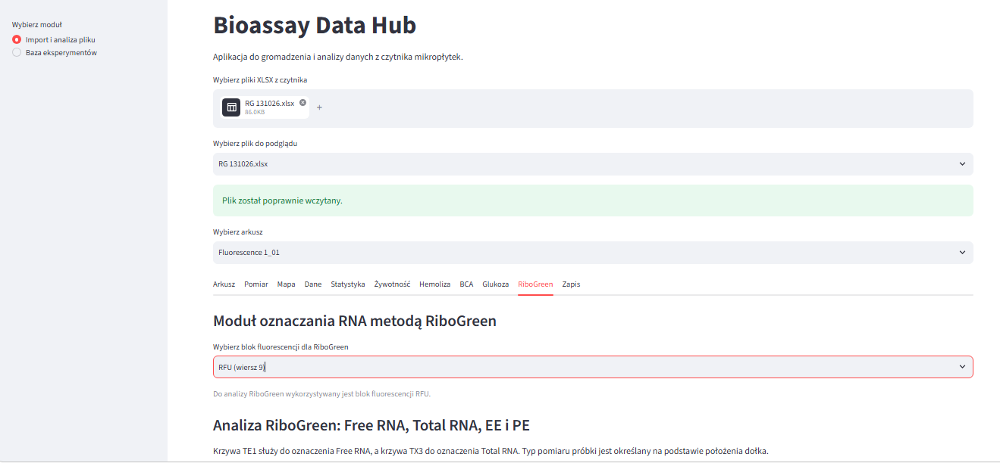
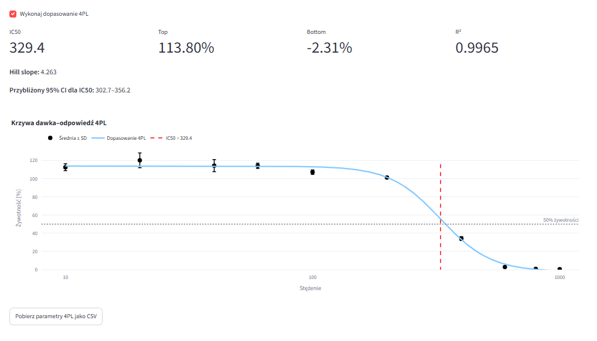
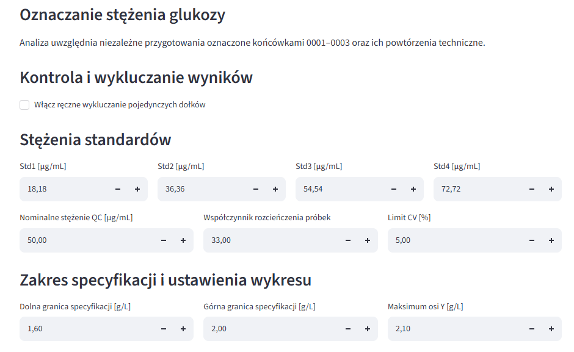
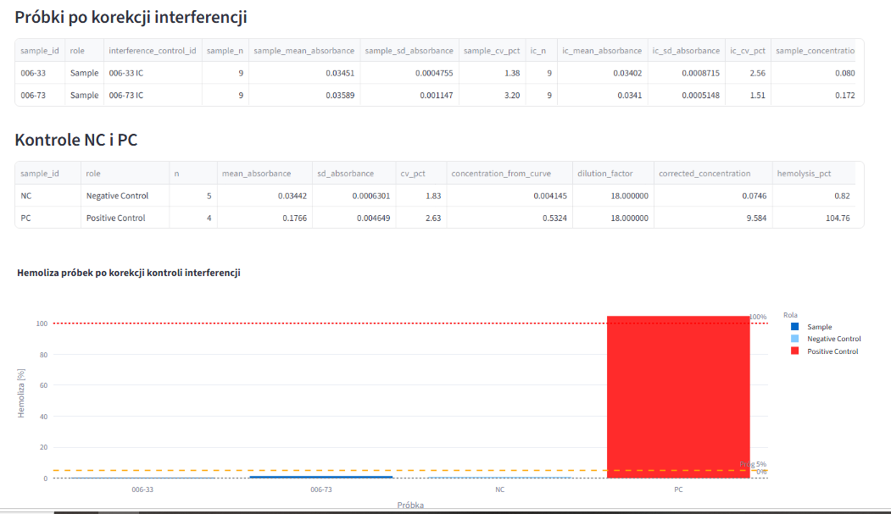
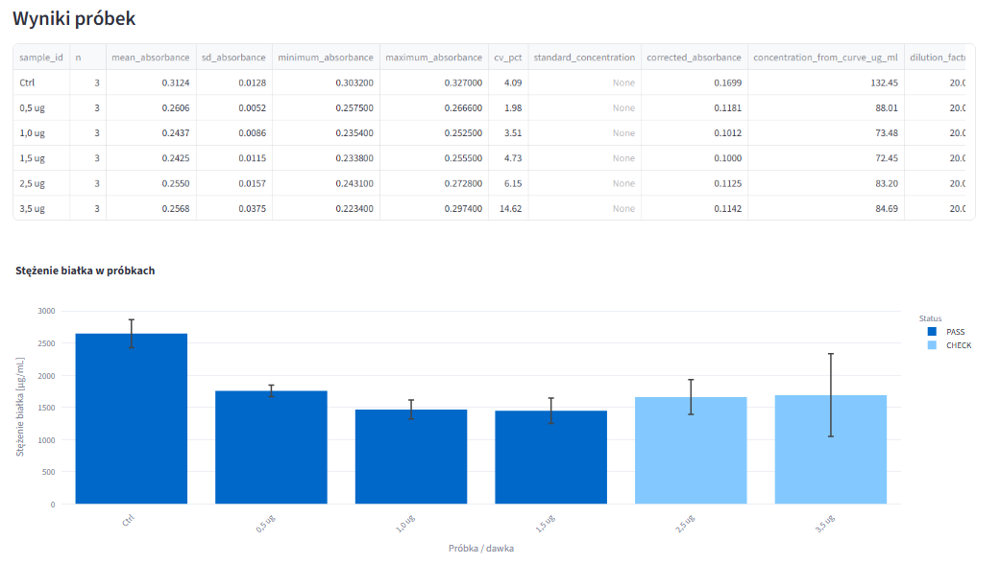
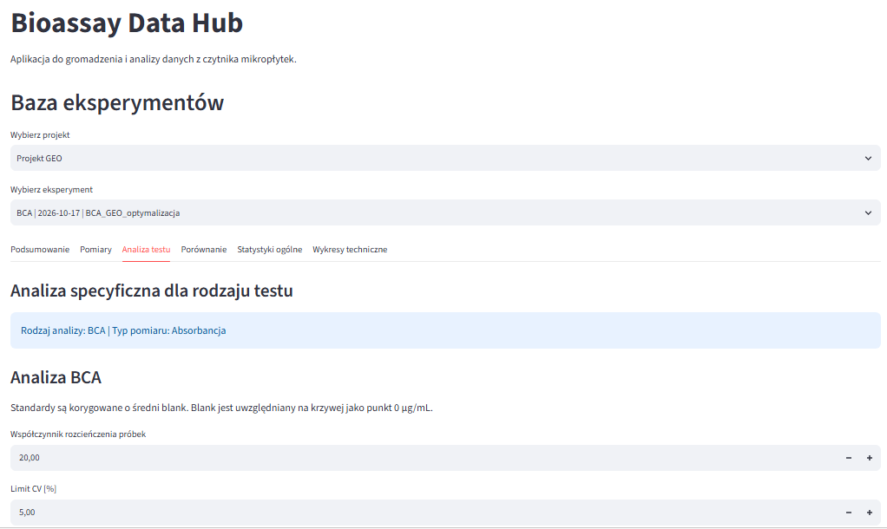

# Bioassay Data Hub

## Opis projektu

Bioassay Data Hub jest aplikacją z graficznym interfejsem użytkownika przeznaczoną do importowania, analizowania, wizualizacji i archiwizacji danych pomiarowych generowanych przez czytnik mikropłytek.

Aplikacja automatycznie rozpoznaje bloki pomiarowe płytek 96-dołkowych, odczytuje mapę próbek, łączy identyfikatory próbek z wynikami oraz wykonuje obliczenia statystyczne i analizy właściwe dla wybranego testu biologicznego.

Projekt realizuje temat:

**Analiza danych pomiarowych z urządzeń.**

Źródłem danych są pliki XLSX eksportowane z czytnika mikropłytek. Aplikacja obsługuje pomiary absorbancji, fluorescencji i luminescencji.

## Cel projektu

Celem aplikacji jest ograniczenie ręcznego przepisywania danych oraz automatyzacja analizy wyników z płytek 96-dołkowych.

Aplikacja umożliwia:

- wczytywanie danych pomiarowych z plików XLSX,
- automatyczne wykrywanie bloków Abs, RFU i RLU,
- odczyt mapy próbek,
- połączenie wyników z identyfikatorami próbek,
- obliczanie statystyk opisowych,
- wykonywanie analiz biologicznych,
- generowanie tabel i wykresów,
- eksport wyników,
- zapis eksperymentów w lokalnej bazie SQLite,
- ponowne analizowanie zapisanych eksperymentów,
- porównywanie wybranych eksperymentów.

## Najważniejsze funkcje

### Import danych

- wczytywanie jednego lub wielu plików XLSX,
- wybór pliku oraz arkusza,
- podgląd surowej zawartości arkusza,
- rozpoznawanie bloków:
  - `Abs` – absorbancja,
  - `RFU` – fluorescencja,
  - `RLU` – luminescencja,
- odczyt pełnej macierzy płytki 96-dołkowej,
- odczyt sekcji `Sample`,
- przypisanie identyfikatora próbki do każdego dołka.

### Analiza ogólna

- tabela surowych wyników,
- mapa płytki,
- tabela wyników połączonych z identyfikatorami,
- heatmapa płytki,
- średnia,
- odchylenie standardowe,
- minimum i maksimum,
- współczynnik zmienności CV,
- kontrola liczby powtórzeń,
- eksport danych i statystyk do CSV.

### Analiza żywotności

- korekcja o blank,
- dopasowanie próbki do odpowiedniej kontroli,
- obliczanie żywotności w procentach,
- średnia, SD i CV,
- wykres dawka–odpowiedź,
- model czteroparametrowy 4PL,
- obliczanie IC50,
- współczynnik R²,
- tabela parametrów dopasowania,
- automatyczne podsumowanie wyników,
- porównywanie kilku eksperymentów na jednym wykresie.

### Analiza hemolizy

- obsługa kwalifikacji krwi PFH/TBH,
- obsługa właściwego testu hemolizy,
- krzywa kalibracyjna,
- ocena kalibratorów i QC,
- obliczenia PFH, TBH oraz TBHd,
- korekcja o kontrolę interferencji,
- obliczanie procentu hemolizy,
- kontrole NC i PC,
- wykres wyników,
- automatyczne podsumowanie,
- porównywanie eksperymentów zapisanych w bazie.

### Analiza BCA

- rozpoznawanie standardów BCA,
- korekcja o blank,
- liniowa krzywa standardowa,
- równanie regresji i R²,
- średnia, SD i CV,
- obliczanie stężenia białka,
- uwzględnienie współczynnika rozcieńczenia,
- kontrola zakresu krzywej,
- wykres wyników próbek,
- kalkulator przygotowania próbek do Western blot,
- obliczanie objętości próbki, buforu Laemmli 2× i wody,
- eksport analizy i przygotowania próbek do XLSX.

### Oznaczanie stężenia glukozy

- dwupoziomowa analiza powtórzeń technicznych i niezależnych przygotowań,
- liniowa krzywa standardowa,
- korekcja o blank,
- kontrola jakości krzywej,
- obliczanie zgodności wartości obliczonej z nominalną,
- wyświetlanie SD i CV,
- edytowalny współczynnik rozcieńczenia,
- wynik końcowy w g/L,
- edytowalny zakres specyfikacji,
- wizualizacja wyników na tle specyfikacji,
- ręczne wykluczanie pojedynczych dołków,
- opcjonalne obliczanie recovery dla próbek wzbogaconych.

### Baza eksperymentów

- lokalna baza SQLite,
- zapis metadanych eksperymentu,
- zapis wszystkich 96 pomiarów,
- filtrowanie według projektu,
- wybór konkretnego eksperymentu,
- ponowne uruchomienie analizy bez pliku źródłowego,
- eksport pomiarów i statystyk,
- bezpieczne usuwanie eksperymentów,
- automatyczne usuwanie powiązanych pomiarów,
- porównywanie wybranych eksperymentów.

## Technologie

Projekt wykorzystuje:

- Python,
- Streamlit,
- Pandas,
- NumPy,
- Plotly,
- SciPy,
- OpenPyXL,
- SQLite,
- Git,
- GitHub.

## Struktura projektu

```text
BioassayDataHub/
├── main.py
├── database.py
├── viability.py
├── viability_comparison.py
├── hemolysis_astm.py
├── hemolysis_assay.py
├── hemolysis_comparison.py
├── bca.py
├── glucose.py
├── excluded_results.py
├── ribogreen.py
├── requirements.txt
├── README.md
├── SPECIFICATION.md
├── sample_data/
└── screenshots/
```

## Instalacja

### 1. Pobranie repozytorium

```powershell
git clone https://github.com/Kld1337/PythonProject2.git BioassayDataHub
cd BioassayDataHub
```

### 2. Utworzenie środowiska wirtualnego

```powershell
python -m venv .venv
```

### 3. Aktywacja środowiska w PowerShell

```powershell
.\.venv\Scripts\Activate.ps1
```

### 4. Instalacja zależności

```powershell
python -m pip install -r requirements.txt
```

## Uruchomienie

```powershell
python -m streamlit run main.py
```

Po uruchomieniu aplikacja otworzy się w domyślnej przeglądarce internetowej.

## Przykład użycia

1. Uruchom aplikację.
2. W panelu bocznym wybierz `Import i analiza pliku`.
3. Wgraj przykładowy plik XLSX z katalogu `sample_data`.
4. Wybierz plik oraz arkusz.
5. Sprawdź zakładki: Arkusz, Pomiar, Mapa, Dane i Statystyka.
6. Otwórz zakładkę odpowiadającą rodzajowi analizy.
7. Ustaw wymagane parametry obliczeń.
8. Sprawdź tabelę wyników, wykresy oraz podsumowanie.
9. Pobierz raport CSV lub XLSX.
10. Opcjonalnie zapisz eksperyment w lokalnej bazie danych.

## Filtrowanie danych

Użytkownik może filtrować i wybierać analizowane dane poprzez:

- wybór pliku,
- wybór arkusza,
- wybór bloku pomiarowego,
- wybór rodzaju testu,
- wybór projektu,
- wybór eksperymentu,
- wybór eksperymentów do porównania,
- ręczne wykluczanie pojedynczych wyników.

## Raportowanie

Aplikacja umożliwia eksport:

- surowych wyników do CSV,
- mapy płytki do CSV,
- połączonych danych do CSV,
- statystyk do CSV,
- porównań eksperymentów do CSV,
- wyników BCA i przygotowania próbek do Western blot do XLSX,
- listy wykluczonych wyników do CSV.

## Zrzuty ekranu

Zrzuty działania aplikacji znajdują się w katalogu `screenshots`.

### Import danych



### Analiza żywotności



### Analiza stężenia glukozy



### Analiza hemolizy



### Analiza BCA 



### Baza eksperymentów




## Przykładowe dane

Katalog `sample_data` zawiera zanonimizowane dane demonstracyjne przygotowane do sprawdzenia działania aplikacji.

Dane demonstracyjne nie zawierają nazw klientów, rzeczywistych identyfikatorów materiałów ani poufnych informacji projektowych.

## Wykorzystanie AI

Narzędzia AI zostały wykorzystane do:

- konsultowania architektury aplikacji,
- przygotowania początkowych elementów interfejsu Streamlit,
- proponowania implementacji funkcji obliczeniowych,
- wyszukiwania i poprawiania błędów,
- porządkowania kodu,
- przygotowania części dokumentacji.

Założenia analityczne, wzory laboratoryjne, układ danych wejściowych oraz oczekiwany sposób działania poszczególnych modułów zostały określone przez autora projektu.

Kod był rozwijany etapowo i testowany na danych pomiarowych oraz danych demonstracyjnych. Autor projektu rozumie sposób działania zastosowanych funkcji, obliczeń statystycznych, modeli regresji i mechanizmu zapisu danych.

## Ograniczenia

- Aplikacja oczekuje danych w określonym układzie płytek 96-dołkowych.
- Plik wejściowy musi zawierać blok pomiarowy oraz sekcję `Sample`.
- Niektóre moduły wymagają określonego nazewnictwa standardów i kontroli.
- Wyniki analiz laboratoryjnych powinny być zweryfikowane zgodnie z obowiązującą procedurą.
- Baza SQLite jest lokalna i nie jest synchronizowana przez Git.
- Wykluczenia pojedynczych wyników nie są obecnie zapisywane trwale w bazie.

## Planowane rozszerzenia

- pełna walidacja modułu RiboGreen,
- analiza GFP mRNA,
- analiza luminescencji Fluc mRNA,
- trwałe zapisywanie wykluczeń,
- dodatkowe formaty raportów,
- dalsze rozszerzanie porównywania eksperymentów.

## Autor

Klaudia Bontor
